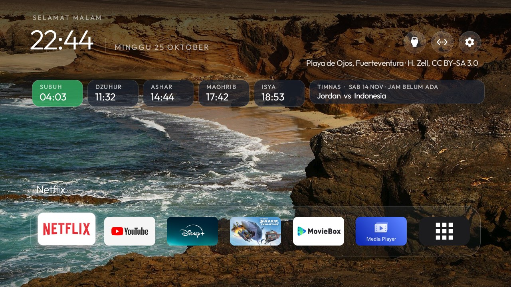

# Family Home TV

A family Home screen for Android TV and Google TV: photos from a shared Google Photos album on today's
date in earlier years, the five prayer times and football fixtures, right on Home, no clicks. Built for a
family in Indonesia on top of the [cleanyourtv](https://github.com/Gathin23/cleanyourtv) launcher and tools
(MIT), whose own README is kept in [UPSTREAM.md](UPSTREAM.md). It runs every day on two TCL 32" G06 sets
(Google TV 11, 1.4 GB RAM).



What it adds to the cleanyourtv launcher:

| Part | What it does | Network |
|---|---|---|
| Photo carousel (`photo_panel`) | Four cards above the dock: three narrow and one wide with the date the photo was taken. A new picture comes in every 9 seconds and the others move left. | none in the launcher |
| Prayer times (`prayer_location`) | One row under the clock: Subuh, Dzuhur, Ashar, Maghrib, Isya, the next one lit. Computed on the TV with Kemenag's angles (Fajr 20°, Isha 18°), within a minute of Aladhan's method 20. | none |
| Football (`football_row`) | One cell after the prayer times, turning every 8 seconds: Timnas Indonesia, Liga 1 and the Champions League, with live scores. | none in the launcher |
| Album sync (add-on `photo-screensaver`) | Reads a shared Google Photos album once a day and keeps up to 30 photos taken on today's date in earlier years. Also the TV's screensaver. | `photos.google.com` |
| Football data (add-on `football`) | Fetches ESPN's public JSON every 30 minutes. Also a full page of fixtures as a card. | `site.api.espn.com` |

The launcher still has no `INTERNET` permission. The two add-ons fetch the data and share it with the launcher
through content providers protected by a **signature** permission, so only apps signed with the same key can
read them. Build all three on the same computer and they share its debug key.

All three keys are off unless a theme turns them on.

## Ringkasan (Bahasa Indonesia)

Proyek ini mengubah home Android TV menjadi layar keluarga:

- **Carousel foto** dari album Google Photos bersama. Setiap hari TV memilih foto yang diambil pada tanggal
  yang sama di tahun-tahun sebelumnya ("hari ini, tahun lalu").
- **Jadwal sholat** 5 waktu di bawah jam. Dihitung di TV dengan metode Kemenag, tanpa internet.
- **Jadwal bola** Timnas, Liga 1 dan Liga Champions, berganti otomatis, dengan skor live.

Cara termudah: buka Claude Code (atau agen AI lain yang bisa menjalankan perintah) di komputer yang satu
Wi-Fi dengan TV, lalu tempel prompt di bagian [Prompt for a coding agent](#prompt-for-a-coding-agent).
Agen akan bertanya kota, link album, dan liga yang diinginkan, lalu memasang semuanya.

Catatan:

- Album dibaca seperti halaman web Google Photos membacanya, bukan lewat API resmi. Kalau Google mengubah
  halamannya, sinkronisasi berhenti; foto yang sudah ada tetap tampil.
- Siapa pun yang punya link album bisa melihat isinya. Pakai album khusus untuk TV.
- Data bola dari ESPN juga tidak resmi. Liga 1 kosong selama ESPN belum memuat musim berjalan.
- Skor live di home bisa terlambat sampai 30 menit.

## Before you start

- An Android TV or Google TV on Android 8 or later, already cleaned up with upstream's
  [PROMPT.md](PROMPT.md), or at least with this launcher installed as Home.
- A Mac, Linux or Windows computer on the same network, with JDK 17 and Android SDK 34 (see the launcher's
  build section in [UPSTREAM.md](UPSTREAM.md)), and `python3 -m venv tools/venv && tools/venv/bin/pip install -r tools/requirements.txt`.
- USB debugging on the TV (Settings > System > Developer options), and its IP address.
- For photos: a Google Photos album made for the TV, shared by link (Share > Create link). A **live album**
  that adds photos of chosen people by itself keeps it filled without any work.

## Tutorial

All commands run from the repository root. Replace `192.168.1.50` with the TV's address.

```bash
export TV_HOST=192.168.1.50
export JAVA_HOME=<path to JDK 17> ANDROID_HOME=<path to the Android SDK>
```

### 1. Install the add-ons first

The launcher only gets the signature permissions if the add-ons are already on the TV when it is installed.

```bash
# Photos: album sync, screensaver and the carousel's source
bash addons/photo-screensaver/build-and-install.sh

# Football: fixtures, scores and the ticker's source
(cd addons/football && ./gradlew assembleRelease)
tools/venv/bin/python -I tools/b64push.py addons/football/app/build/outputs/apk/release/app-release.apk /data/local/tmp/addon.apk
tools/venv/bin/python -I tools/tv.py 'pm install -r /data/local/tmp/addon.apk; rm -f /data/local/tmp/addon.apk'
tools/venv/bin/python -I tools/tv.py 'am start -n io.github.agungksidik.football/.MainActivity'
```

Opening the football page once schedules its background refresh.

### 2. Point Photos at your album

```bash
addons/photo-screensaver/album.sh https://photos.app.goo.gl/XXXX
```

The first pictures arrive within a minute. Hold OK in the slideshow for its settings; **Three prints** and
**When a picture was taken** suit phone photos. `album.sh --off` stops it and removes the album pictures.

### 3. Install the launcher

```bash
HOME_KEY_SERVICE=1 RESTORE_KEY_SERVICES=1 launcher/build-and-install.sh
```

Check that the permissions were granted:

```bash
tools/venv/bin/python -I tools/tv.py 'dumpsys package com.gathin.tvhome | grep -E "READ_(ALBUM|MATCHES): granted"'
```

Both lines should say `granted=true`. If not, install the launcher again: the add-ons were not there yet.

### 4. Push a theme with the new keys

Copy [`docs/fork/family-home.json`](docs/fork/family-home.json) into a theme folder as `config.json`, set your
city and push it:

```bash
mkdir -p work/family-home && cp docs/fork/family-home.json work/family-home/config.json
# edit work/family-home/config.json: "prayer_location": "<latitude>,<longitude>"
tools/theme.sh work/family-home
```

| Key | Value | Effect |
|---|---|---|
| `photo_panel` | `true` | The carousel. Needs the Photos add-on with an album set. |
| `prayer_location` | `"-6.2088,106.8456"` | The five prayer times for that place, in the TV's time zone. Empty leaves them out. |
| `football_row` | `true` | The football cell. Needs the football add-on. |
| `rows_below_dock` | `0` | Pushes the dock down, which leaves room for the carousel. |

Put wallpapers in `work/family-home/wallpapers/` as upstream's themes do (1280x720 JPEGs). With
`wallpaper_captions`, credit each picture in `wallpapers/captions.txt`.

### 5. Answer the card prompts and close ADB

Press Home. The launcher asks once per add-on whether to show its card; either answer is fine, the carousel
and the ticker do not depend on it. Then switch USB debugging off on the TV and check the port is closed:

```bash
tools/adb-closed.py 192.168.1.50
```

The add-ons keep fetching on their own; ADB is only needed to change the setup.

## Check the TV's time zone

Prayer times follow the TV's clock. One of the two test TVs came from the factory on `GMT+00:00`, which put
every time seven hours off. Check it:

```bash
tools/venv/bin/python -I tools/tv.py 'getprop persist.sys.timezone; date'
```

Fix it in Settings > Date & time, or over ADB:

```bash
tools/venv/bin/python -I tools/tv.py 'settings put global auto_time_zone 0; service call alarm 3 s16 Asia/Jakarta'
```

## Prompt for a coding agent

Paste this into Claude Code, or another coding agent with a shell, opened in a clone of this branch on a
computer on the same network as the TV.

```text
You are setting up "Family Home TV" from this repository (branch family-home) on my Android TV. Read README.md,
AGENTS.md and PROMPT.md first and follow their safety rules: disable, never uninstall; back up first; keep the
Home guard; ask before anything the family uses.

1. Ask me for: the TV's IP address; whether the TV is already cleaned up with this repo (if not, run PROMPT.md
   first); the city for prayer times (turn it into latitude,longitude); the share link of a Google Photos album
   made for the TV (suggest a live album of chosen people); whether I want the football row.
2. Connect with tools/tv.py and check: Android version 8 or later, `dumpsys window | grep mSafeMode`, the time
   zone (`getprop persist.sys.timezone`). If the time zone is wrong for my city, tell me and fix it only after
   I agree.
3. Follow README.md's tutorial in order: add-ons first, then the album link, then the launcher with
   HOME_KEY_SERVICE=1 RESTORE_KEY_SERVICES=1, then a theme from docs/fork/family-home.json with my
   prayer_location. Keep my existing app_keys and dock_apps if the TV already has a theme in work/.
4. Verify that READ_ALBUM and READ_MATCHES show granted=true for com.gathin.tvhome, then take a screenshot of
   Home with tools/tv.py --screenshot and look at it: prayer row, football cell, carousel with pictures. If the
   carousel is empty, check the album sync (`ls /sdcard/Android/data/com.gathin.photodream/files/pictures`).
5. Never put the album link, my IP address, my city or screenshots of my family into git or anything public.
6. At the end, tell me what was installed and how to undo it (tools/theme.sh --reset, album.sh --off,
   pm uninstall of the add-ons), and remind me to switch USB debugging off; then run tools/adb-closed.py.
```

## Undo

```bash
tools/theme.sh --reset                                    # upstream look, keys off
addons/photo-screensaver/album.sh --off                   # album pictures removed
tools/venv/bin/python -I tools/tv.py 'pm uninstall io.github.agungksidik.football'
bash addons/photo-screensaver/build-and-install.sh --uninstall
```

## Limits

- The launcher APK is about 495 KB with these keys, over upstream's 480 KB gate. That is why this lives in its
  own repository and not in an upstream pull request.
- The album is read the way its web page reads itself (`snAcKc`), not through a Google API. A change on
  Google's side stops the sync; the pictures already on the TV keep showing.
- ESPN's API is unofficial: day ranges and Java's default user agent are already refused. Liga 1 stays empty
  while ESPN has no data for the current season.
- The ticker's live scores can be up to 30 minutes old; the football page itself refreshes every 2 minutes
  during a match.
- Tested only on TCL 32" G06 (Google TV 11, firmware AR2101, MediaTek, 1280x720).

## Credits

Upstream launcher, tools and the photo screensaver add-on: [cleanyourtv](https://github.com/Gathin23/cleanyourtv)
and its contributors (MIT). Prayer time method: [praytimes.org](http://praytimes.org). The look was inspired by
[ZeroPulseTV](https://github.com/steventa2024-lgtm/ZeroPulseTV).
